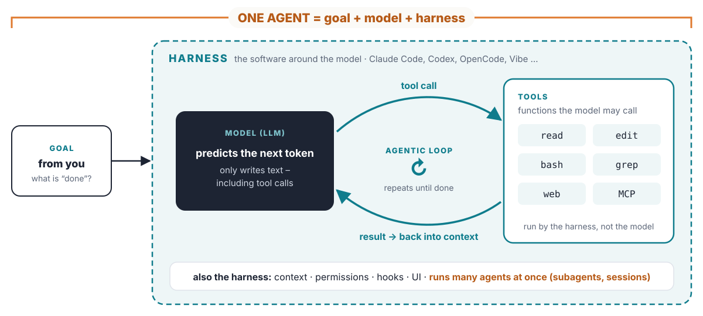
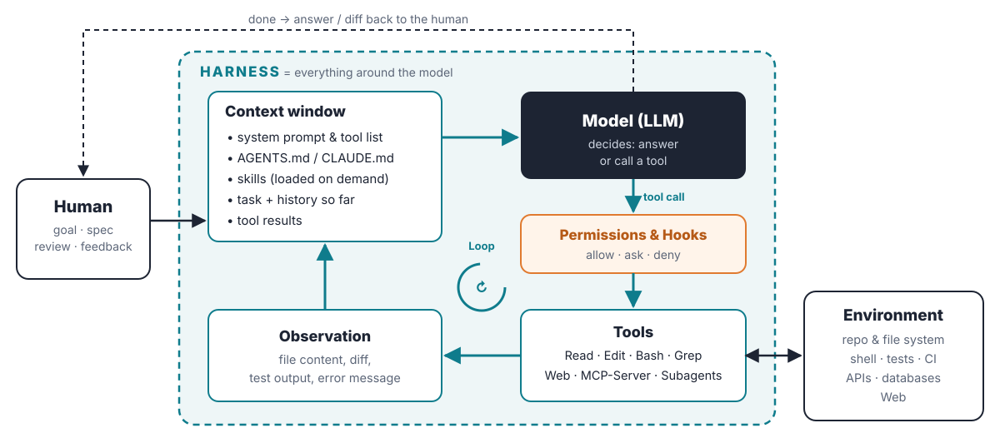
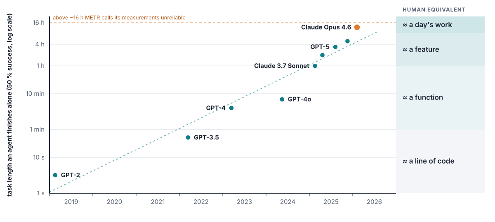
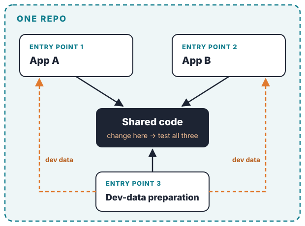

## Terms (1/2): what is an agent?

{.full}

::: notes
~1 min. Read the picture from the inside out: the model only writes text. The harness turns tool calls into real actions and feeds the results back – that's the loop. Add a goal from you, and the whole thing is an agent: agent = goal + model + harness.
Note: one harness can run many agents – e.g. subagents, or an orchestrator that splits a goal into tasks and starts one session per task. Each of those is again goal + model + loop + tools.
Key distinction: model ≠ agent ≠ harness. The model doesn't “do” anything – the harness executes.
:::

## Inside the harness: one turn of the loop

{.full}

::: notes
~2 min. The model only decides “text or tool call”. The harness executes, checks permissions, runs hooks, collects results and builds the next context.
Consequence: the same model performs differently in different harnesses – which is why benchmarks like Terminal-Bench always rate the model + harness pair.
:::

## Terms (2/2): how do we steer it?

::: {.cards .c3 .terms}
::: {.card .term}
[Context]{.ct}

Everything the model sees in one step. Limited, costs tokens, crowds out the rest.
:::
::: {.card .term}
[AGENTS.md]{.ct}

Project file the harness always loads into context: commands, conventions, rules.

[CLAUDE.md · GEMINI.md]{.ex}
:::
::: {.card .term}
[Skill]{.ct}

Folder with instructions (+ scripts), loaded only when needed.
:::
::: {.card .term}
[MCP]{.ct}

Model Context Protocol – open standard to plug in external tools and data.
:::
::: {.card .term}
[Hook]{.ct}

Deterministic script the harness runs on events, e.g. before every tool call.
:::
:::

::: notes
~1 min. These are the knobs we will talk about in the best-practice part.
:::

## How did we get here?

{.full}

::: notes
~1.5 min. Three jumps: autocomplete (Copilot) → chat → agent in the terminal with tool access. Next slide: what these jumps mean in numbers.
2025 was the year of terminal agents; since late 2025 standardisation (AGENTS.md, MCP under the Linux Foundation's Agentic AI Foundation).
2026: focus shifts from the prompt to the harness (“harness engineering”, OpenAI, Feb 2026) – and the first solid studies appear.
Dec 2025: the Linux Foundation launched the Agentic AI Foundation (AAIF) with Anthropic's MCP, OpenAI's AGENTS.md and Block's goose as founding projects – the core standards are no longer owned by one vendor, so the same AGENTS.md and MCP servers work across harnesses.
Jan 2026: OpenClaw (formerly Clawdbot/Moltbot) goes viral – an open-source agent that runs 24/7, you talk to it via Signal/Telegram/WhatsApp, and it can access mail, calendar and other services. Also a security lesson: leaked secrets, malicious skills, prompt injection.
2026: cloud agents (Claude Code cloud sessions, Codex Cloud, Cursor Cloud Agents) keep working with the laptop closed.
Next? Always-on agents with access to all the services they need – vendors already market “super agents”. The open question is less “can they?” than “what may they touch?”.
:::

## From handholding to delegation

{.full}

[**Source:** METR, *Task-Completion Time Horizons of Frontier AI Models*, [metr.org/time-horizons](https://metr.org/time-horizons/) (last updated Sep 8, 2026; data file `benchmark_results_1_1.yaml`). Time Horizon 1.1 values; GPT-2 and GPT-3.5 from the original 2025 suite. 50 % horizon = task length, measured in human expert time, at which the agent is predicted to succeed half the time. Trend line and “human equivalent” labels: our illustration.]{.tiny}

::: notes
~2 min. This is the one chart to remember. Each point is a model; the y-axis is how long a human would need for the tasks the model finishes alone half of the time. Log scale: every gridline step is a big jump.
2023 (GPT-4): a few minutes – you had to check in after every small step. Early 2026 (Claude Opus 4.6): about 12 hours – a day's work, in principle (95 % CI roughly 5–60 h).
Doubling roughly every 4–6 months (METR: ~4.3 months since 2023).
Caveats: 50 % ≠ “safe to delegate” (80 % horizons are several times shorter), error bars are about ×2 either way, and METR's own suite is nearly saturated above ~16 h.
Message: the habits we built for the old models – approving every step, long instruction files – were built for the left half of this chart.
:::

## What's different from writing code yourself?

::: {.cards .c2}
::: {.card .accent}
[From author to reviewer]{.ct}

I write the goal and the constraints, the agent writes the code. My main job: **make the task clear, check the result**.
:::
::: {.card .accent}
[Non-deterministic]{.ct}

Same task, different path. Token usage for the very same task varies by up to **30×** (Bai et al. 2026).
:::
::: {.card .accent}
[Context instead of memory]{.ct}

The agent only knows the project as far as it is in the context – every session starts from zero.
:::
::: {.card .warn}
[Felt ≠ measured]{.ct}

METR (2025): experienced OSS developers felt **20 % faster** – but were **19 % slower** with AI.
:::
:::

::: notes
~2 min. METR study: 16 experienced developers, their own large repos, early-2025 tools. Models have improved since – the point stands: measure, don't guess.
:::

## Which harness should I choose?

| Harness | Vendor | License | Models | Customise via |
|---|---|---|---|---|
| **Claude Code** | Anthropic | proprietary | Claude | CLAUDE.md, skills, hooks, plugins, Agent SDK |
| **Codex CLI** | OpenAI | Apache-2.0 | OpenAI (+ configurable providers) | AGENTS.md, skills, MCP |
| **Gemini CLI** | Google | Apache-2.0 | Gemini | GEMINI.md, extensions, MCP |
| **opencode** | community | MIT | 75+ providers, incl. EU hosting & local | AGENTS.md, agents, plugins, MCP |
| **Mistral Vibe** | Mistral (FR) | open source | Devstral / Mistral | agent profiles, permissions, MCP |
| **Build your own** | you | – | any | agent SDKs or ~100 lines of your own loop |

[**Criteria:** Where does my data go (GDPR!)? · Am I locked into one model vendor? · How customisable is it? · What does the team use? · Cost per task]{.small}

::: notes
~2 min. For non-profits, data protection is often the deciding factor → open harnesses (opencode, Vibe) with EU-hosted models.
Building your own is great for understanding (workshop!), rarely for daily work.
State: October 2026 – the landscape changes monthly; the concepts (loop, tools, context file, permissions, hooks) are the same everywhere.
:::

## Step back: what changes in how we work

::: {.cards .c2}
::: {.card .warn}
[Then (early 2026 habits)]{.ct}

- Short runs, the agent stops early, you correct constantly
- CLAUDE.md full of **IMPORTANT!!!** and stack details
- Approve every single command – or skip permissions entirely
- Read every diff at the end
:::
::: {.card .good}
[Now (Claude 5.5-era models)]{.ct}

- Hand over a **much bigger task** and say what *done* looks like
- Only write down what the agent **can't see in the code**
- **Auto mode + deny rules** instead of clicking “approve”
- **Checkpoints that pass or fail** (tests, hooks, CI) instead of reading every diff
:::
:::

::: {.cards .c2 .stats}
::: {.card .accent}
[14 %]{.stat .inline}
[of people approving commands caught a clearly dangerous one]{.stat-label}
:::
::: {.card .accent}
[89 %]{.stat .inline}
[were blocked by Claude Code's auto-mode classifier]{.stat-label}
:::
:::

[**Source:** Lydia Hallie (Anthropic), *Rethinking Claude Code Best Practices*, AI Engineer, Nov 11, 2026 – [youtube.com/watch?v=vlfCjWuv4es](https://www.youtube.com/watch?v=vlfCjWuv4es). The 14 % / 89 % figures are from an internal Anthropic study (Aug 2026) cited in the talk.]{.tiny}

::: notes
~2.5 min. Based on Lydia Hallie's talk from this week. Her core message: much of what we added to our setups over the past year now holds the newer models back.
Humans are bad gatekeepers: when you approve dozens of commands, you stop reading them. A classifier plus a few hard deny rules does better.
Trust is not blind: you replace “watching every step” with checkpoints that fail loudly.
:::

## Best practice 1: AGENTS.md – only what the agent can't see

:::: {.columns}
::: {.column width="52%"}
```{.markdown filename="AGENTS.md"}
## Commands
- Setup: `uv sync`
- Tests: `uv run pytest -q`
- Lint: `uv run ruff check --fix`

## Conventions you can't see in the code
- Never write to `data/raw/`
- New analyses: Quarto files in `reports/`
- Column names always snake_case

## Definition of done
- Tests green, ruff clean
- No new dependencies without asking
```
:::
::: {.column width="48%"}
::: {.card .good}
**Put in**

- Commands (build, test, lint)
- Non-obvious conventions
- Prohibitions & “definition of done”
:::

::: {.card .warn}
**Leave out**

- Stack details and “where to look” – the agent explores itself
- What's already in the README / linter
- Auto-generated text (`/init`)
- **IMPORTANT!!!** – emphasis makes newer models over-react
:::
:::
::::

::: notes
~2 min. Keep it short (< 100 lines), human-written, only what the agent can't figure out itself. Every line costs tokens on every call.
Hallie's example of what belongs in: “this service still reads from a legacy data source that isn't referenced anywhere in the repo”. And: re-audit the file whenever you switch to a newer model – instructions written for older models can now make results worse.
AGENTS.md is the vendor-neutral format; Claude Code reads CLAUDE.md – tip: CLAUDE.md just contains `@AGENTS.md`.
Meta: this deck lives in a repo with its own AGENTS.md – have a look!
:::

## From practice: make the entry points explicit

:::: {.columns}
::: {.column width="47%"}
{width="100%"}
:::
::: {.column width="53%"}
::: {.bigquote .sm}
“The agent must always know what the entry points of the repo are.”
:::

[— Benjamin Fries, from his company projects]{.tiny}

```{.markdown filename="AGENTS.md (sketch)"}
## Entry points
- app_a/  → `uv run app-a`   uses shared/
- app_b/  → `uv run app-b`   uses shared/
- prep/   → `uv run prep`    writes data/dev/
## When you change …
- shared/      → run tests of app_a AND app_b
- prep/ schema → update fixtures of both apps
```
:::
::::

::: notes
~2.5 min (Benjamin). One repo, two small applications that share code, plus a third entry point that prepares data for development.
Without documented dependencies the agent fixes one entry point and silently breaks another – “Schiefstände”, things drifting out of sync.
This is exactly the kind of knowledge the agent can't reliably infer from the code: which parts belong together and what has to be re-checked after a change. The excerpt is a simplified sketch, names changed.
:::

## Best practice 2: hard limits, then let it run

:::: {.columns}
::: {.column width="50%"}
```{.json filename=".claude/settings.json"}
{
  "permissions": {
    "deny": ["Read(./.env*)",
             "Read(./secrets/**)",
             "Bash(git push:*)"],
    "ask":  ["Bash(uv add:*)"]
  },
  "hooks": {
    "PostToolUse": [{
      "matcher": "Edit|Write",
      "hooks": [{ "type": "command",
                  "command": "ruff format" }]
    }]
  }
}
```
:::
::: {.column width="50%"}
::: {.card .accent}
**Deny rules** = the only hard stop. Ask: *“If it gets this wrong once, can I take it back?”* If not → deny rule.
:::

::: {.card .accent}
**Auto mode / allow-list** for everything reversible: tests, installs, edits in the repo
:::

::: {.card .warn}
**Careful:** a deny rule on `.env` doesn't stop *your test script* from loading it. Real isolation: **sandbox / cloud session**, secrets outside the repo.
:::
:::
::::

::: notes
~2 min. Wrong code can be reverted – a deleted branch, discarded changes or a key in the transcript can't. Those get deny rules; everything else runs without asking.
Sandboxes only cover shell commands and their children; file tools, MCP servers and hooks run outside. Hallie's preferred option: a cloud session with its own machine – no .env, no SSH keys on it.
Skills from the internet are code: an analysis of 31,000 community skills found at least one exploitable vulnerability in 26 % of them.
:::

## Best practice 3: checkpoints instead of watching

:::: {.columns}
::: {.column width="50%"}
::: {.card .accent}
[Say what *done* looks like]{.ct}

Split work into tasks that each come with their own test. Ask the agent to **show the actual output**, not to claim success.
:::

::: {.card .accent}
[Hooks = checkpoints that always run]{.ct}

- every edit → linter
- task marked complete → relevant tests
- session about to end → full test suite
:::
:::
::: {.column width="50%"}
```{.bash filename=".claude/hooks/run-tests.sh"}
#!/usr/bin/env bash
uv run pytest -q || {
  echo "Tests fail – fix them" >&2
  exit 2  # block + send back
}
```

::: {.card .warn}
**Gotcha:** most tools exit with `1` on failure – Claude Code treats that as non-blocking and moves on. Only exit code **2** sends the agent back to fix it.
:::

::: {.card}
**Then:** CI as the backstop, and human review scaled to risk.
:::
:::
::::

::: notes
~2 min. Instead of reading every diff, define pass/fail gates. Hallie's example: an OAuth migration can be done three ways – keep the old API, migrate only new logins, or log everyone out. The “log everyone out” run fails the first test, without anyone reading the diff.
Review ladder: agent review first, then none / one / two human reviewers depending on risk.
:::

## What does the research say?

::: {.cards .c2}
::: {.card .accent}
[AGENTS.md (ETH Zurich, ICLR 2026)]{.ct}

4 agents, SWE-bench Lite + 138 tasks from repos with real context files

- **LLM-generated:** success rate –0.5 to –2 pp, **cost +20–23 %**
- **Human-written:** approx. +2.4 pp (not significant), **cost up to +19 %**
- Agents follow the file – they test and explore more, but do *not* find relevant files faster
:::
::: {.card .accent}
[SkillsBench (Feb 2026)]{.ct}

84 tasks, 11 domains, 7 model–harness combinations

- **Curated skills:** +16.2 pp on average – but **software engineering only +4.5 pp** (healthcare +52)
- **Self-generated skills:** ≈ **0 to –1.8 pp**
- 2–3 focused skills work best; comprehensive documentation skills hurt (–2.9 pp)
:::
:::

[**Takeaway:** Knowledge the model already has adds nothing – but costs tokens. Value comes only from *real* specialist knowledge that is short and human-curated. More tokens ≠ more accuracy (Bai et al. 2026).]{.small}

::: notes
~2 min. This is the core. Not “skills/CLAUDE.md are useless”, but: for coding in standard stacks, modern models already know most of it. Context files and skills are a cost that only pays off for non-obvious knowledge.
pp = percentage points.
:::

## Skills vs. placebo: a controlled test

:::: {.columns}
::: {.column width="40%"}
::: {.card .accent}
[skill-placebo (Sep 2026)]{.ct}

9 popular skills vs. **neutral text of the same length**, loaded the same way. Claude Code + Opus 5.5, 15 tasks, 30 trials per arm, pre-registered.

<div class="stat">2 / 9</div>
<div class="stat-label">beat the placebo – only on cost (−5 % and −12 %), not on pass rate</div>

- 6 no better, 1 **worse** (–20 pp)
- None cheaper than **no skill at all**
- The placebo alone adds **+2–16 %** cost
:::
:::
::: {.column width="60%"}
::: {.card .warn}
[Claims vs. measured]{.ct}

| Skill | Claimed | Measured |
|---|---|---|
| caveman | 65 % fewer tokens | **+18 %** total tokens, +14 % cost |
| ponytail | ~20 % cheaper | **–1 %** cost |
| planning-with-files | 96.7 % pass rate | 80 % vs. 87 % without skill |
:::

::: {.card}
**Caveats:** one model and harness, short public tasks near the ceiling, long-session skills not covered. A single-author benchmark, not peer-reviewed – but all trials are published.
:::
:::
::::

::: notes
~1.5 min. The cleanest design I know: it separates “the skill's content helps” from “any extra text in the context changes behaviour”. Most of the effect people attribute to skills is the placebo effect of more context – and it costs money.
Fits SkillsBench: generic, popular skills for coding add little; value comes from specific, curated knowledge.
:::

## What has lost weight – and what has gained

::: {.cards .c2}
::: {.card .warn}
[Losing weight]{.ct}

- Prompt tricks (“You are a senior dev …”, magic words)
- Long, generated CLAUDE.md / AGENTS.md files
- Repo descriptions – the agent explores by itself
- Large skill collections from the internet
- Approving every command by hand
:::
::: {.card .good}
[Gaining weight]{.ct}

- **Clear task / spec** – what does “done” mean?
- **Verification:** tests, linters, CI as feedback loop
- **Boundaries:** deny rules, sandbox, auto mode
- **Choice & configuration of the harness**
- **Review & responsibility** stay with humans
:::
:::

::: notes
~1.5 min. From “prompt engineering” (2023) via “context engineering” (2025) to “harness engineering” (2026): we optimise less and less the text we send to the model and more and more the environment it works in.
:::

## Spec-driven development

::: {.cards .c3}
::: {.card .accent}
[1 · Spec]{.ct}

*What* and *why*: goal, acceptance criteria, non-goals. Written / reviewed by a human.
:::
::: {.card .accent}
[2 · Plan & tasks]{.ct}

The agent proposes an implementation (plan mode), the human corrects it **before** any code exists.
:::
::: {.card .accent}
[3 · Implement & verify]{.ct}

The agent implements task by task; tests derived from the acceptance criteria are the yardstick.
:::
:::

<br>

- Tools: GitHub **Spec Kit**, AWS **Kiro**, OpenSpec – or simply a `SPEC.md` + plan mode
- A bare user story instead of a full spec costs **~30 % more tokens** (Smékal 2026)
- The spec becomes the artefact you review – not every line of code

::: notes
~1.5 min. A spec doesn't replace review, but it moves the most important review moment to the front: mistakes in the spec are cheap, mistakes in the code are expensive.
:::

## Agentic coding in civil society: the hard parts

::: {.cards .c2}
::: {.card .warn}
[Data protection]{.ct}

Data about vulnerable people – US providers often off-limits.

**~50 %** of AI-using nonprofits name privacy risks¹
:::

::: {.card .warn}
[Expertise]{.ct}

No in-house tech staff, no rules → "shadow AI".

**41 %** lack in-house tech expertise¹ · **76 %** have no AI strategy²
:::

::: {.card .warn}
[Money]{.ct}

Tokens and tools compete with the mission.

**69 %**: budget is the main obstacle³ · **60 %** no support for digital costs³
:::

::: {.card .warn}
[Who maintains it?]{.ct}

Volunteers move on – non-techies inherit the code.

**78 %** of organisations (Bavaria) have no paid staff⁴
:::
:::

[¹ Fast Forward 2025 (US) · ² TechSoup 2025 (US) · ³ Charity Digital Skills 2025 (UK) · ⁴ ZiviZ 2023]{.small}

::: notes
~1.5 min. We build for organisations without an IT department – that shapes every choice in this workshop.

- Data protection: NGOs hold data about children, patients, refugees. GDPR is a real legal uncertainty for volunteer boards (ZiviZ). Shadow AI: staff paste data into tools nobody approved.
- Expertise: Fast Forward surveyed ~200 nonprofits that already use AI – so the real gap is bigger. 41 % lack tech expertise, nearly half name privacy risks, 84 % name funding for tools and talent as their greatest need.
- Money: UK Charity Digital Skills Report 2025 (n = 672): 69 % budget squeeze, 60 % no support for digital costs.
- Maintenance: ZiviZ 2023 Bavaria: only 22 % of organisations have any paid staff. Whatever we build must survive the handover.

Transition: these constraints are the backdrop for our discussion – and the reason the workshop setup (11:30) looks the way it does.
:::

## Discussion: where does the human stay?

::: {.cards .c2}
::: {.card .accent}
[Responsibility]{.ct}

- Who owns code that nobody wrote line by line? *“You commit it, you own it”* – enough?
- How much review is enough when the agent works for hours?
:::
::: {.card .accent}
[Skills & learning]{.ct}

- What do we still need to understand ourselves?
- How do junior devs learn when the agent solves the exercises?
:::
::: {.card .accent}
[Non-profits]{.ct}

- Which data may enter the context at all?
- EU-hosted open models vs. frontier models: what's the trade-off for us?
:::
::: {.card .good}
[Our contribution]{.ct}

- If AI can code (almost) everything: problem understanding, judgement, domain knowledge – and responsibility towards the people affected
:::
:::

::: notes
Open discussion, ~10 min. Start with a quick show of hands: who uses a coding agent daily? Who let one work alone for more than an hour?
:::

## Try it yourself

::: {.bigquote}
Coding Agents: intro workshop<br>**today, 11:30 – 12:30**
:::

<br>

- Build a survey-analysis pipeline with a coding agent – step by step, ready prompts
- Open harness (**OpenCode 2**) + open models in **German data centres** (IONOS)
- Guardrails that keep the agent away from personal data · ~€0.10 per pipeline step
- Bring a laptop – please install `uv` and OpenCode 2 beforehand (`SETUP.md` in the repo)

::: notes
Pointer to the workshop slot after the break.
:::

## Sources

::: {.sources}
- METR (2026): *Task-Completion Time Horizons of Frontier AI Models* (updated Sep 8, 2026). [metr.org/time-horizons](https://metr.org/time-horizons/) · METR (Jan 29, 2026): *Time Horizon 1.1.* [metr.org/blog](https://metr.org/blog/2026-01-29-time-horizon-1-1/)
- Hallie, L. (2026): *Rethinking Claude Code Best Practices.* AI Engineer, Nov 2026. [YouTube](https://www.youtube.com/watch?v=vlfCjWuv4es)
- OpenClaw (formerly Clawdbot / Moltbot). [Wikipedia](https://en.wikipedia.org/wiki/OpenClaw) · GitGuardian (Jan 2026): *OpenClaw (Moltbot) personal assistant goes viral – and so do your secrets.* [blog.gitguardian.com](https://blog.gitguardian.com/moltbot-personal-assistant-goes-viral-and-so-do-your-secrets/)
- Fast Forward (2025): *AI for Humanity Report* (via [Chronicle of Philanthropy](https://www.philanthropy.com/news/nonprofits-are-embracing-ai-but-many-struggle-to-find-funding/)) · TechSoup/Tapp (2025): *AI Benchmark Report* ([blog.techsoup.org](https://blog.techsoup.org/posts/what-ai-means-for-nonprofits-in-2025-insights-from-the-ai-benchmark-report)) · *Charity Digital Skills Report 2025* ([summary](https://digitalskills.mdia.gov.mt/skills-intelligence/charity-digital-skills-report-2025/)) · *ZiviZ-Survey 2023* ([ziviz.de](https://ziviz.de/sites/ziv/files/ziviz-survey_2023_vereine_und_andere_zivilgesellschaftliche_organisationen.pdf))
- Gloaguen, Mündler, Müller, Raychev, Vechev (2026): *Evaluating AGENTS.md: Are Repository-Level Context Files Helpful for Coding Agents?* ICLR 2026. [arXiv:2602.11988](https://arxiv.org/abs/2602.11988)
- Li et al. (2026): *SkillsBench: Benchmarking How Well Agent Skills Work Across Diverse Tasks.* [arXiv:2602.12670](https://arxiv.org/abs/2602.12670)
- Bai et al. (2026): *How Do AI Agents Spend Your Money? Analyzing and Predicting Token Consumption in Agentic Coding Tasks.* [arXiv:2604.22750](https://arxiv.org/abs/2604.22750)
- Smékal (2026): *Can your AI agent be cheaper? Investigating the effects of task specifications on token spend in agentic coding tasks.* [arXiv:2608.25399](https://arxiv.org/abs/2608.25399)
- Simon (@simonether) (2026): *skill-placebo – benchmarking coding-agent skills against a same-length placebo.* [github.com/simonether/skill-placebo](https://github.com/simonether/skill-placebo)
- Security analysis of 31,132 community skills (2026). [arXiv:2601.10338](https://arxiv.org/abs/2601.10338)
- METR (2025): *Measuring the Impact of Early-2025 AI on Experienced Open-Source Developer Productivity.* [metr.org](https://metr.org/blog/2025-07-10-early-2025-ai-experienced-os-dev-study/)
- Yao et al. (2022): *ReAct: Synergizing Reasoning and Acting in Language Models.* [arXiv:2210.03629](https://arxiv.org/abs/2210.03629)
- OpenAI (2026): *Harness engineering.* [openai.com](https://openai.com/index/harness-engineering/) · Coverage: [InfoQ](https://www.infoq.com/news/2026/02/openai-harness-engineering-codex)
- AGENTS.md: [agents.md](https://agents.md) · Agentic AI Foundation (Linux Foundation, Dec 2025)
- Claude Code settings, permissions & hooks: [docs.claude.com](https://docs.claude.com/en/docs/claude-code/settings)
- Mistral Vibe: [docs.mistral.ai](https://docs.mistral.ai/mistral-vibe/overview)
:::
