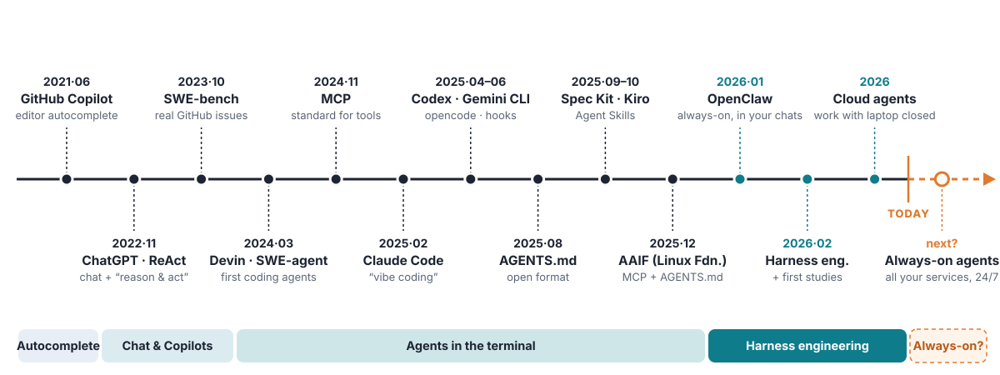

## Terms (1/2): what is an agent?

::: {.cards .c3 .terms}
::: {.card .term}
[Model (LLM)]{.ct}

Predicts the next token. Can't execute anything – it only writes text, including tool calls.
:::
::: {.card .term}
[Tool]{.ct}

A function the model may call.

[read · edit · bash · web search]{.ex}
:::
::: {.card .term}
[Agentic loop]{.ct}

Model → tool call → result back into context → next step … until done.
:::
::: {.card .term}
[Agent]{.ct}

Model + loop + tools + a goal. Works autonomously over many steps.
:::
::: {.card .term}
[Harness]{.ct}

The software around the model: loop, tools, context, permissions, hooks, UI.

[Claude Code · Codex · opencode · Vibe]{.ex}
:::
:::

::: notes
~1 min. Key distinction: model ≠ agent ≠ harness. The model doesn't “do” anything – the harness executes.
:::

## Terms (2/2): how do we steer it?

::: {.cards .c3 .terms}
::: {.card .term}
[Context]{.ct}

Everything the model sees in one step. Limited, costs tokens, crowds out the rest.
:::
::: {.card .term}
[AGENTS.md]{.ct}

Project file the harness always loads into context: commands, conventions, rules.

[CLAUDE.md · GEMINI.md]{.ex}
:::
::: {.card .term}
[Skill]{.ct}

Folder with instructions (+ scripts), loaded only when needed.
:::
::: {.card .term}
[MCP]{.ct}

Model Context Protocol – open standard to plug in external tools and data.
:::
::: {.card .term}
[Hook]{.ct}

Deterministic script the harness runs on events, e.g. before every tool call.
:::
:::

::: notes
~1 min. These are the knobs we will talk about in the best-practice part.
:::

## How did we get here?

{.full}

::: notes
~1.5 min. Three jumps: autocomplete (Copilot) → chat → agent in the terminal with tool access.
2025 was the year of terminal agents; since late 2025 standardisation (AGENTS.md, MCP under the Linux Foundation's Agentic AI Foundation).
2026: focus shifts from the prompt to the harness (“harness engineering”, OpenAI, Feb 2026) – and the first solid studies appear.
:::

## What's different from writing code yourself?

::: {.cards .c2}
::: {.card .accent}
[From author to reviewer]{.ct}

I write the goal and the constraints, the agent writes the code. My main job: **make the task clear, check the result**.
:::
::: {.card .accent}
[Non-deterministic]{.ct}

Same task, different path. Token usage for the very same task varies by up to **30×** (Bai et al. 2026).
:::
::: {.card .accent}
[Context instead of memory]{.ct}

The agent only knows the project as far as it is in the context – every session starts from zero.
:::
::: {.card .warn}
[Felt ≠ measured]{.ct}

METR (2025): experienced OSS developers felt **20 % faster** – but were **19 % slower** with AI.
:::
:::

::: notes
~2 min. METR study: 16 experienced developers, their own large repos, early-2025 tools. Models have improved since – the point stands: measure, don't guess.
:::

## The harness: agent = model + loop + tools

{.full}

::: notes
~2 min. The model only decides “text or tool call”. The harness executes, checks permissions, runs hooks, collects results and builds the next context.
Consequence: the same model performs differently in different harnesses – which is why benchmarks like Terminal-Bench always rate the model + harness pair.
:::

## Which harness should I choose?

| Harness | Vendor | License | Models | Customise via |
|---|---|---|---|---|
| **Claude Code** | Anthropic | proprietary | Claude | CLAUDE.md, skills, hooks, plugins, Agent SDK |
| **Codex CLI** | OpenAI | Apache-2.0 | OpenAI (+ configurable providers) | AGENTS.md, skills, MCP |
| **Gemini CLI** | Google | Apache-2.0 | Gemini | GEMINI.md, extensions, MCP |
| **opencode** | community | MIT | 75+ providers, incl. EU hosting & local | AGENTS.md, agents, plugins, MCP |
| **Mistral Vibe** | Mistral (FR) | open source | Devstral / Mistral | agent profiles, permissions, MCP |
| **Build your own** | you | – | any | agent SDKs or ~100 lines of your own loop |

[**Criteria:** Where does my data go (GDPR!)? · Am I locked into one model vendor? · How customisable is it? · What does the team use? · Cost per task]{.small}

::: notes
~2 min. For non-profits, data protection is often the deciding factor → open harnesses (opencode, Vibe) with EU-hosted models.
Building your own is great for understanding (workshop!), rarely for daily work.
State: October 2026 – the landscape changes monthly; the concepts (loop, tools, context file, permissions, hooks) are the same everywhere.
:::

## Best practice 1: AGENTS.md – a map, not an encyclopedia

:::: {.columns}
::: {.column width="52%"}
```{.markdown filename="AGENTS.md"}
## Commands
- Setup: `uv sync`
- Tests: `uv run pytest -q`
- Lint: `uv run ruff check --fix`

## Conventions you can't see in the code
- Never write to `data/raw/`
- New analyses: Quarto files in `reports/`
- Column names always snake_case

## Definition of done
- Tests green, ruff clean
- No new dependencies without asking
```
:::
::: {.column width="48%"}
::: {.card .good}
**Put in**

- Commands (build, test, lint)
- Non-obvious conventions
- Prohibitions & “definition of done”
:::

::: {.card .warn}
**Leave out**

- Repo overview (the agent finds it itself)
- What's already in the README / linter
- Auto-generated text (`/init`)
- Style prose and “You are an expert …”
:::
:::
::::

::: notes
~2 min. Keep it short (< 100 lines), human-written, only what the agent can't figure out itself. Every line costs tokens on every call.
AGENTS.md is the vendor-neutral format; Claude Code reads CLAUDE.md – tip: CLAUDE.md just contains `@AGENTS.md`.
Meta: this deck lives in a repo with its own AGENTS.md – have a look!
:::

## Best practice 2: set boundaries – permissions & hooks

:::: {.columns}
::: {.column width="50%"}
```{.json filename=".claude/settings.json"}
{
  "permissions": {
    "deny": ["Read(./.env*)",
             "Read(./secrets/**)",
             "Bash(git push:*)"],
    "ask":  ["Bash(uv add:*)"]
  },
  "hooks": {
    "PostToolUse": [{
      "matcher": "Edit|Write",
      "hooks": [{ "type": "command",
                  "command": "ruff format" }]
    }]
  }
}
```
:::
::: {.column width="50%"}
::: {.card .accent}
**Permissions** = what the agent may do: `allow` · `ask` · `deny`
:::

::: {.card .accent}
**Hooks** = what *always* happens – deterministic, not “please remember” in AGENTS.md
:::

::: {.card .warn}
**Careful:** denying `Read(.env)` doesn't stop `cat .env` via the shell. Real security only with a **sandbox / container** and secrets outside the repo.
:::
:::
::::

::: notes
~2 min. Rule of thumb: anything that must always happen (formatting, blocking secrets, tests after edits) → hook. Anything the agent must not do → permission / sandbox. AGENTS.md only for knowledge.
Skills from the internet are code: an analysis of 31,000 community skills found at least one exploitable vulnerability in 26 % of them.
:::

## What does the research say?

::: {.cards .c2}
::: {.card .accent}
[AGENTS.md (ETH Zurich, ICLR 2026)]{.ct}

4 agents, SWE-bench Lite + 138 tasks from repos with real context files

- **LLM-generated:** success rate –0.5 to –2 pp, **cost +20–23 %**
- **Human-written:** approx. +2.4 pp (not significant), **cost up to +19 %**
- Agents follow the file – they test and explore more, but do *not* find relevant files faster
:::
::: {.card .accent}
[SkillsBench (Feb 2026)]{.ct}

84 tasks, 11 domains, 7 model–harness combinations

- **Curated skills:** +16.2 pp on average – but **software engineering only +4.5 pp** (healthcare +52)
- **Self-generated skills:** ≈ **0 to –1.8 pp**
- 2–3 focused skills work best; comprehensive documentation skills hurt (–2.9 pp)
:::
:::

[**Takeaway:** Knowledge the model already has adds nothing – but costs tokens. Value comes only from *real* specialist knowledge that is short and human-curated. More tokens ≠ more accuracy (Bai et al. 2026).]{.small}

::: notes
~2 min. This is the core. Not “skills/CLAUDE.md are useless”, but: for coding in standard stacks, modern models already know most of it. Context files and skills are a cost that only pays off for non-obvious knowledge.
pp = percentage points.
:::

## Skills vs. placebo: a controlled test

:::: {.columns}
::: {.column width="40%"}
::: {.card .accent}
[skill-placebo (Sep 2026)]{.ct}

9 popular skills vs. **neutral text of the same length**, loaded the same way. Claude Code + Opus 5.5, 15 tasks, 30 trials per arm, pre-registered.

<div class="stat">2 / 9</div>
<div class="stat-label">beat the placebo – only on cost (−5 % and −12 %), not on pass rate</div>

- 6 no better, 1 **worse** (–20 pp)
- None cheaper than **no skill at all**
- The placebo alone adds **+2–16 %** cost
:::
:::
::: {.column width="60%"}
::: {.card .warn}
[Claims vs. measured]{.ct}

| Skill | Claimed | Measured |
|---|---|---|
| caveman | 65 % fewer tokens | **+18 %** total tokens, +14 % cost |
| ponytail | ~20 % cheaper | **–1 %** cost |
| planning-with-files | 96.7 % pass rate | 80 % vs. 87 % without skill |
:::

::: {.card}
**Caveats:** one model and harness, short public tasks near the ceiling, long-session skills not covered. A single-author benchmark, not peer-reviewed – but all trials are published.
:::
:::
::::

::: notes
~1.5 min. The cleanest design I know: it separates “the skill's content helps” from “any extra text in the context changes behaviour”. Most of the effect people attribute to skills is the placebo effect of more context – and it costs money.
Fits SkillsBench: generic, popular skills for coding add little; value comes from specific, curated knowledge.
:::

## What has lost weight – and what has gained

::: {.cards .c2}
::: {.card .warn}
[Losing weight]{.ct}

- Prompt tricks (“You are a senior dev …”, magic words)
- Long, generated CLAUDE.md / AGENTS.md files
- Repo descriptions – the agent explores by itself
- Large skill collections from the internet
- Which exact model? (gaps are shrinking)
:::
::: {.card .good}
[Gaining weight]{.ct}

- **Clear task / spec** – what does “done” mean?
- **Verification:** tests, linters, CI as feedback loop
- **Boundaries:** permissions, sandbox, hooks
- **Choice & configuration of the harness**
- **Review & responsibility** stay with humans
:::
:::

::: notes
~1.5 min. From “prompt engineering” (2023) via “context engineering” (2025) to “harness engineering” (2026): we optimise less and less the text we send to the model and more and more the environment it works in.
:::

## Spec-driven development

::: {.cards .c3}
::: {.card .accent}
[1 · Spec]{.ct}

*What* and *why*: goal, acceptance criteria, non-goals. Written / reviewed by a human.
:::
::: {.card .accent}
[2 · Plan & tasks]{.ct}

The agent proposes an implementation (plan mode), the human corrects it **before** any code exists.
:::
::: {.card .accent}
[3 · Implement & verify]{.ct}

The agent implements task by task; tests derived from the acceptance criteria are the yardstick.
:::
:::

<br>

- Tools: GitHub **Spec Kit**, AWS **Kiro**, OpenSpec – or simply a `SPEC.md` + plan mode
- A bare user story instead of a full spec costs **~30 % more tokens** (Smékal 2026)
- The spec becomes the artefact you review – not every line of code

::: notes
~1.5 min. A spec doesn't replace review, but it moves the most important review moment to the front: mistakes in the spec are cheap, mistakes in the code are expensive.
:::

## Agentic coding in civil society: the hard parts

::: {.cards .c2}
::: {.card .warn}
[Data protection]{.ct}

Data about vulnerable people – US providers often off-limits.

**~50 %** of AI-using nonprofits name privacy risks¹
:::

::: {.card .warn}
[Expertise]{.ct}

No in-house tech staff, no rules → "shadow AI".

**41 %** lack in-house tech expertise¹ · **76 %** have no AI strategy²
:::

::: {.card .warn}
[Money]{.ct}

Tokens and tools compete with the mission.

**69 %**: budget is the main obstacle³ · **60 %** no support for digital costs³
:::

::: {.card .warn}
[Who maintains it?]{.ct}

Volunteers move on – non-techies inherit the code.

**78 %** of organisations (Bavaria) have no paid staff⁴
:::
:::

**Our setup:** EU-hosted open models · guardrails · pay-per-use (~€40/workshop)

[¹ Fast Forward 2025 (US) · ² TechSoup 2025 (US) · ³ Charity Digital Skills 2025 (UK) · ⁴ ZiviZ 2023]{.small}

::: notes
~1.5 min. We build for organisations without an IT department – that shapes every choice in the workshop.

- Data protection: NGOs hold data about children, patients, refugees. GDPR is a real legal uncertainty for volunteer boards (ZiviZ). Shadow AI: staff paste data into tools nobody approved.
- Expertise: Fast Forward surveyed ~200 nonprofits that already use AI – so the real gap is bigger. 41 % lack tech expertise, nearly half name privacy risks, 84 % name funding for tools and talent as their greatest need.
- Money: UK Charity Digital Skills Report 2025 (n = 672): 69 % budget squeeze, 60 % no support for digital costs.
- Maintenance: ZiviZ 2023 Bavaria: only 22 % of organisations have any paid staff. Whatever we build must survive the handover.

Transition: that is why the workshop setup looks the way it does.
:::

## Our workshop setup: EU-only, two models, guardrails

::: {.cards .c3}
::: {.card .accent}
[1 · You prompt]{.ct}

Ready prompts per pipeline step: prepare → spam → topics → classify → report.

[OpenCode 2 · `uv run agent`]{.ex}
:::
::: {.card .accent}
[2 · Agent writes code]{.ct}

**Qwen3-Coder-Next** writes the code – never sees raw data, never runs the pipeline.

[IONOS, Germany · €0.15 / 1M input tokens]{.ex}
:::
::: {.card .accent}
[3 · Code asks a model]{.ct}

Your code sends batches of comments to **gpt-oss-120b**; you run it and review the results.

[same provider, same key · cents per run]{.ex}
:::
:::

::: {.cards .c3}
::: {.card .warn}
[Instructions]{.ct}

`AGENTS.md`: rules, commands, quiet output, data protection
:::
::: {.card .warn}
[Policies & hooks]{.ct}

Only IONOS · no `.env`, no raw data · keys hidden · prompts read-only · ruff after every edit
:::
::: {.card .warn}
[Cost]{.ct}

~60k tokens per agent step ≈ **€0.01** → **~€40** for 20 people
:::
:::

::: notes
~1.5 min. Bridge from the civil-society slide to the hands-on part.

- Two models, two jobs: the coding agent (Qwen3-Coder-Next) writes code; the code the agent writes calls a second model (gpt-oss-120b) for the actual analysis. Both on IONOS: one provider, one key, data stays in Germany, no training on it.
- The agent never sees personal data: raw and interim data are blocked by policy and hooks; it writes code that processes the data and prints counts. The human runs the pipeline scripts – they call a paid API on real data.
- Guardrails in three layers: AGENTS.md (advice – usually followed), policies (hard rules nothing overrides), hooks (deterministic: hide API keys, run ruff and feed errors back). Honest caveat: hooks catch accidents, only isolation is a security boundary.
- Cost, measured: the agent resends its whole context with every step – ~60k tokens on average, no prompt caching on IONOS – about €0.01 per step; a smooth pipeline step ~€0.15, one full test run of steps 2–5 with retries ~€13. The analysis itself costs cents.
- Why not Scaleway/GLM? Scaleway limits tokens per minute per organisation (1–2M); 20 people with an agent need ~5M. IONOS limits requests (5/s per model) instead.
:::

## Responsibility: where does the human stay?

::: {.todo}
**Placeholder – to be worked out together.** Possible guiding questions:

- Who is responsible for code that nobody wrote line by line? (“You commit it, you own it”)
- What do we still need to understand ourselves – and what can we delegate?
- How do junior devs learn when the agent solves the exercises?
- Data protection & ethics in non-profits: which data may enter the context at all?
- If AI can code (almost) everything: what is our contribution? Understanding the problem, judgement, domain knowledge, responsibility towards the people affected
:::

::: notes
Deliberately left open – bridge into the discussion.
:::

## From practice: what a good AGENTS.md achieves

::: {.todo}
**Placeholder – Benjamin's company projects.** Suggested structure:

- Starting point: project, stack, team size
- Before / after: what concretely changed thanks to the AGENTS.md?
- A real (anonymised) excerpt – which 3 lines help most?
- What did *not* work / was removed again?
:::

## Sources

::: {.sources}
- Gloaguen, Mündler, Müller, Raychev, Vechev (2026): *Evaluating AGENTS.md: Are Repository-Level Context Files Helpful for Coding Agents?* ICLR 2026. [arXiv:2602.11988](https://arxiv.org/abs/2602.11988)
- Li et al. (2026): *SkillsBench: Benchmarking How Well Agent Skills Work Across Diverse Tasks.* [arXiv:2602.12670](https://arxiv.org/abs/2602.12670)
- Bai et al. (2026): *How Do AI Agents Spend Your Money? Analyzing and Predicting Token Consumption in Agentic Coding Tasks.* [arXiv:2604.22750](https://arxiv.org/abs/2604.22750)
- Smékal (2026): *Can your AI agent be cheaper? Investigating the effects of task specifications on token spend in agentic coding tasks.* [arXiv:2608.25399](https://arxiv.org/abs/2608.25399)
- Simon (@simonether) (2026): *skill-placebo – benchmarking coding-agent skills against a same-length placebo.* [github.com/simonether/skill-placebo](https://github.com/simonether/skill-placebo)
- Security analysis of 31,132 community skills (2026). [arXiv:2601.10338](https://arxiv.org/abs/2601.10338)
- METR (2025): *Measuring the Impact of Early-2025 AI on Experienced Open-Source Developer Productivity.* [metr.org](https://metr.org/blog/2025-07-10-early-2025-ai-experienced-os-dev-study/)
- Yao et al. (2022): *ReAct: Synergizing Reasoning and Acting in Language Models.* [arXiv:2210.03629](https://arxiv.org/abs/2210.03629)
- OpenAI (2026): *Harness engineering.* [openai.com](https://openai.com/index/harness-engineering/) · Coverage: [InfoQ](https://www.infoq.com/news/2026/02/openai-harness-engineering-codex)
- AGENTS.md: [agents.md](https://agents.md) · Agentic AI Foundation (Linux Foundation, Dec 2025)
- Claude Code settings, permissions & hooks: [docs.claude.com](https://docs.claude.com/en/docs/claude-code/settings)
- Mistral Vibe: [docs.mistral.ai](https://docs.mistral.ai/mistral-vibe/overview)
- Fast Forward (2025): *AI for Humanity Report*, via Chronicle of Philanthropy. [philanthropy.com](https://www.philanthropy.com/news/nonprofits-are-embracing-ai-but-many-struggle-to-find-funding/)
- TechSoup & Tapp Network (2025): *AI Benchmark Report.* [techsoup.org](https://blog.techsoup.org/posts/what-ai-means-for-nonprofits-in-2025-insights-from-the-ai-benchmark-report)
- Charity Digital Skills Report 2025 (n = 672 UK charities). [Summary](https://digitalskills.mdia.gov.mt/skills-intelligence/charity-digital-skills-report-2025/)
- ZiviZ (2023): *ZiviZ-Survey 2023 – Vereine und andere zivilgesellschaftliche Organisationen* (Bavaria report). [ziviz.de](https://ziviz.de/sites/ziv/files/ziviz-survey_2023_vereine_und_andere_zivilgesellschaftliche_organisationen.pdf)
:::
