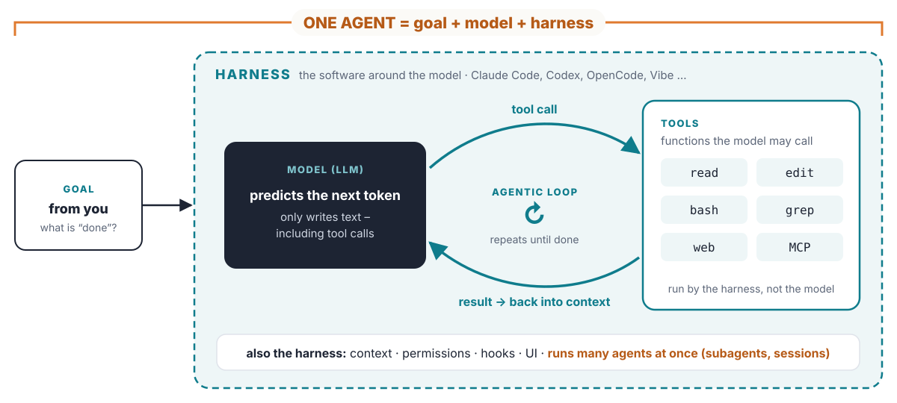
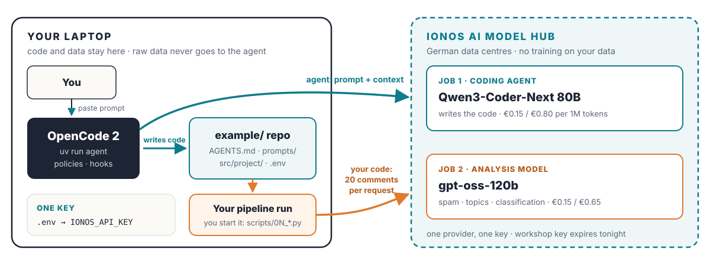
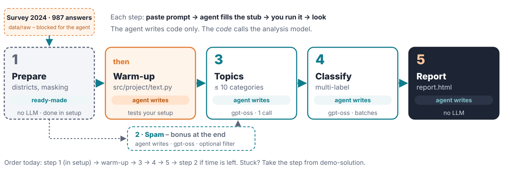

## What you'll take home

::: {.cards .c3}
::: {.card .accent}
[A setup an NGO can use]{.ct}

An open coding agent on your laptop, open models in German data centres, pay per use – no GPU, no subscription.
:::
::: {.card .accent}
[A way of working]{.ct}

You decide *what* and check the result. The agent writes the code. Your code does the analysis.
:::
::: {.card .accent}
[A feel for guardrails & cost]{.ct}

What keeps the agent away from personal data – and what one pipeline step really costs.
:::
:::

::: notes
~1 min. Nobody needs prior experience with coding agents. Python basics help, but you won't write much code yourself.
:::

## Plan for the hour

::: {.bigtable}
| Time | What |
|---|---|
| **11:30** | Coding agents in 5 minutes · why this setup |
| **11:40** | Setup check: `uv run agent`, first prompt |
| **11:50** | Hands-on: pipeline steps 2 – 5, one prompt each (pairs welcome) |
| **12:20** | Costs, trust, what worked and what didn't |
| **12:30** | End |

: {tbl-colwidths="[16,84]"}
:::

::: notes
~1 min. If setup fails for someone: pair up with a neighbour – one laptop for two works well. Step 2 (spam) is optional.
:::

## A coding agent in one picture

{.full}

::: notes
~2 min. Recap for everyone who missed the discussion session. The model only writes text, including tool calls. The harness – today: OpenCode 2 – runs the tools on your laptop, checks policies and permissions, and feeds the results back. That loop repeats until the task is done.
:::

## Agentic coding in civil society: the hard parts

::: {.cards .c2}
::: {.card .warn}
[Data protection]{.ct}

Data about vulnerable people – US providers often off-limits.

**~50 %** of AI-using nonprofits name privacy risks¹
:::

::: {.card .warn}
[Expertise]{.ct}

No in-house tech staff, no rules → "shadow AI".

**41 %** lack in-house tech expertise¹ · **76 %** have no AI strategy²
:::

::: {.card .warn}
[Money]{.ct}

Tokens and tools compete with the mission.

**69 %**: budget is the main obstacle³ · **60 %** no support for digital costs³
:::

::: {.card .warn}
[Who maintains it?]{.ct}

Volunteers move on – non-techies inherit the code.

**78 %** of organisations (Bavaria) have no paid staff⁴
:::
:::

[¹ Fast Forward 2025 (US) · ² TechSoup 2025 (US) · ³ Charity Digital Skills 2025 (UK) · ⁴ ZiviZ 2023]{.small}

::: notes
~1.5 min. We build for organisations without an IT department – that shapes every choice in this workshop.

- Data protection: NGOs hold data about children, patients, refugees. GDPR is a real legal uncertainty for volunteer boards (ZiviZ). Shadow AI: staff paste data into tools nobody approved.
- Expertise: Fast Forward surveyed ~200 nonprofits that already use AI – so the real gap is bigger. 41 % lack tech expertise, nearly half name privacy risks, 84 % name funding for tools and talent as their greatest need.
- Money: UK Charity Digital Skills Report 2025 (n = 672): 69 % budget squeeze, 60 % no support for digital costs.
- Maintenance: ZiviZ 2023 Bavaria: only 22 % of organisations have any paid staff. Whatever we build must survive the handover.

Transition: that is why the workshop setup looks the way it does.
:::

## Our setup: two models, two jobs, one key

{.full}

::: notes
~2 min.
- Two models, two jobs: the coding agent (Qwen3-Coder-Next) writes code; the code the agent writes calls a second model (gpt-oss-120b) for the actual analysis. Both on IONOS: one provider, one key, German data centres, no training on the data.
- The agent never sees personal data: raw and interim data are blocked by policy and hooks; it writes code that processes the data and prints counts. You run the pipeline scripts – they call a paid API on real data.
- Why IONOS and not Scaleway? Measured on 13 Nov: Scaleway allows 200k tokens/min per model on our account – 4 parallel agents already got rate-limited. IONOS (5 requests/s per model) ran 20 simulated agents with zero errors. Details: example/docs/infrastructure.md.
:::

## Setup – three steps

:::: {.columns}
::: {.column width="60%"}
```{.bash filename="terminal"}
# 1 · install (ideally before the workshop)
curl -LsSf https://astral.sh/uv/install.sh | sh
curl -fsSL https://opencode.ai/v2/install | bash

# 2 · code + key
git clone https://github.com/CorrelAid/\
correlcon-2026-agentic-coding-workshop
cd correlcon-2026-agentic-coding-workshop/example
cp .env.example .env
# → paste the key after IONOS_API_KEY=

# 3 · check and start
uv sync
uv run python scripts/check_setup.py
uv run agent
```
:::
::: {.column width="40%"}
::: {.card .warn}
**Start with `uv run agent`** – not plain `opencode`. Plain `opencode` doesn't read `.env` → `401`.
:::

::: {.card .accent}
**First prompt to try:** *“Write a function in src/project/text.py that masks email addresses and phone numbers, add tests and run them.”*<br>≈ 45 s · ≈ €0.02
:::

::: {.card}
Windows: use WSL. Details & troubleshooting: **`SETUP.md`**
:::
:::
::::

::: notes
~10 min incl. helping people. `uv run agent` starts OpenCode 2 from the example/ folder with the keys from .env and --standalone (OpenCode 2 otherwise talks to a shared background service that knows nothing about the project's keys).
check_setup.py tests both models incl. tool calling for less than one cent.
:::

## Five layers of control

::: {.bigtable .compact}
| Layer | File | What it does |
|---|---|---|
| **Instructions** | `AGENTS.md` | Project rules: columns, commands, data protection. Usually followed – not guaranteed. |
| **Skills** | `.agents/skills/privacy-check/` | A procedure loaded only when needed – e.g. a new data source. |
| **Policies** | `opencode.json` | Hard rules: only IONOS · no `.env`, no `data/raw/` – not even via the shell · no pipeline runs · prompts read-only |
| **Permissions** | `opencode.json` | Shell commands ask first – except tests, ruff, `git status` … |
| **Hooks** | `.opencode/plugins/guardrails.ts` | Hide API keys from the shell · block searches in protected folders · run `ruff` after every edit and feed errors back |

: {tbl-colwidths="[18,30,52]"}
:::

::: notes
~2 min. The core message of the discussion session, made concrete: AGENTS.md is advice, policies and hooks are enforced. Honest caveat: hooks catch accidents – only isolation (container, separate machine) is a security boundary.
Try it during step 2: ask the agent “show me 5 raw rows” – watch the hook block it.
:::

## Our data: the Babylotse survey 2024

:::: {.columns}
::: {.column width="55%"}
**Babylotse Frankfurt** (Kinderschutzbund Frankfurt) supports families around the birth of a child. In 2024 it asked families in Frankfurt what they like – and don't like – about life with a baby in the city.

- **987 answers**, in German
- District (typed by hand) + two free-text answers
- **CC BY 4.0** – thanks to Babylotse for publishing it
:::
::: {.column width="45%"}
::: {.card .accent}
[The question]{.ct}

What do families talk about – and does it differ between districts?
:::

::: {.card .warn}
[The rule]{.ct}

The agent never reads raw answers. It writes code that does – and prints only counts.
:::
:::
::::

::: notes
~1.5 min. In 2024 CorrelAid solved this with notebooks and hand-written prompts (workshop-babylotse). Today a coding agent builds the pipeline – the district mapping from 2024 is reused in step 1.
:::

## The pipeline

{.full}

::: notes
~1.5 min. Each step reads the previous step's file and writes its own – steps can be re-run independently. Contracts in docs/pipeline.md.
:::

## One step, start to finish

::: {.cards .c3}
::: {.card .accent}
[1 · Paste the prompt]{.ct}

From `prompts/0N_*.md`. Start a **fresh session** per step – old context costs money.
:::
::: {.card .accent}
[2 · Let it work]{.ct}

The agent fills the stub in `src/project/`, runs the smoke test & ruff, and tells you the command to run.
:::
::: {.card .accent}
[3 · Run it & look]{.ct}

**You** run the script with `--limit 100`, then check the output. Humans decide, the model suggests.
:::
:::

```{.text filename="prompts/03_topics.md (excerpt)"}
- Draw a fixed sample (seed 42) of 50 positive and 50 negative answers.
- Send the whole sample in ONE request to the analysis model via src/project/llm.py.
- Ask for at most 10 neutral categories, in German, each with a description.
- Validate with pydantic, save data/processed/categories_v1.json.
- End the script with sanity checks on its own output. No tests that mock the LLM.
Run `uv run pytest -q` (checks that everything imports), then tell me the command.
```

::: notes
~2 min. Show step 3 live once, then everyone works. The prompts are deliberately specific: input, output, rules, and how to check – that's what a good task description looks like.
:::

## Hands-on: steps 2 – 5

::: {.bigtable}
| Step | Then run | Try this – and what you'll learn |
|---|---|---|
| **2 · Spam** *(optional)* | `scripts/02_spam.py --limit 100` | Ask “show me 5 raw rows” – the hook blocks it |
| **3 · Topics** | `scripts/03_topics.py` | Read the categories together – edit `categories_v1.json` by hand |
| **4 · Classify** | `scripts/04_classify.py --limit 100` | Batches of 20, validation, caching – shared rate limits |
| **5 · Report** | `scripts/05_report.py` | Open `outputs/report.html` – when are tests worth it in a pipeline? |

: {tbl-colwidths="[20,36,44]"}
:::

[Run everything with `uv run python …` inside `example/`. **Stuck?** Copy the finished step from the branch `demo-solution` – see `prompts/README.md`.]{.small}

::: notes
~30 min hands-on, ~8 min per step. Nobody needs to finish all four – step 3 alone is a good result. Skipped step 2? Steps 3–5 use the district check from step 1 as a spam filter.
:::

## What does it cost?

::: {.cards .c3}
::: {.card .accent}
[~€0.01]{.stat .inline}

[per agent step (~60k tokens – the whole context is resent each time)]{.stat-label}
:::
::: {.card .accent}
[€0.08 – 0.15]{.stat .inline}

[a clean pipeline step · a step with many fixes: €1 – 3]{.stat-label}
:::
::: {.card .good}
[~€40]{.stat .inline}

[upper bound for 20 people today · clean runs ~€10 · analysis model: cents]{.stat-label}
:::
:::

<br>

- See your own numbers: **`opencode stats`**
- Hard task? Switch with `/models` to **Qwen3.5 397B** – stronger, ~4× the price
- For an NGO: ~3 volunteers with a few sessions a month ≈ **€8 / month**

[Measured with the workshop repo, Oct 2026 – details in `example/docs/infrastructure.md`.]{.tiny}

::: notes
~3 min. Ask 2–3 pairs for their `opencode stats`. The point: the money is in the agent's context, not in the analysis – fresh sessions and quiet output (AGENTS.md: “Keep output short”) are the main cost levers. The expensive part is your time when the agent goes wrong.
:::

## Ground rules for today

::: {.cards .c2}
::: {.card .warn}
[Data]{.ct}

Only public or synthetic data with the workshop key – never your organisation's personal data.
:::
::: {.card .warn}
[The workshop key]{.ct}

Runs on CorrelAid's account and **expires tonight**. Don't commit it, don't post it.
:::
::: {.card .accent}
[Review]{.ct}

Read the diff before you commit. You own what you commit – not the agent.
:::
::: {.card .accent}
[Blocked or stuck?]{.ct}

“Blocked by policy” is working as intended. Agent looping? **Esc**, fresh session – or take the step from `demo-solution`.
:::
:::

::: notes
Show this right before hands-on starts.
:::

## Wrap-up

::: {.cards .c3}
::: {.card .accent}
[Where did you step in?]{.ct}

Which step needed the most correction – and why?
:::
::: {.card .accent}
[Would you trust it?]{.ct}

Would you hand the report to Babylotse as it is?
:::
::: {.card .good}
[Back home]{.ct}

Could your NGO use this setup? What's missing?
:::
:::

<br>

- **Repo, prompts, setup:** [github.com/CorrelAid/correlcon-2026-agentic-coding-workshop](https://github.com/CorrelAid/correlcon-2026-agentic-coding-workshop) – the `example/` folder is a template for your own projects
- **Best practices & research:** slides from the 10:45 discussion session (same repo)
- Data: Babylotse Frankfurt, CC BY 4.0 · OpenCode: [opencode.ai](https://opencode.ai) · IONOS AI Model Hub: [docs.ionos.com](https://docs.ionos.com/cloud/ai/ai-model-hub/overview)

::: notes
~5 min.
Sources for the civil-society slide: Fast Forward 2025 AI for Humanity Report (via Chronicle of Philanthropy) · TechSoup/Tapp AI Benchmark Report 2025 · Charity Digital Skills Report 2025 · ZiviZ-Survey 2023.
:::
